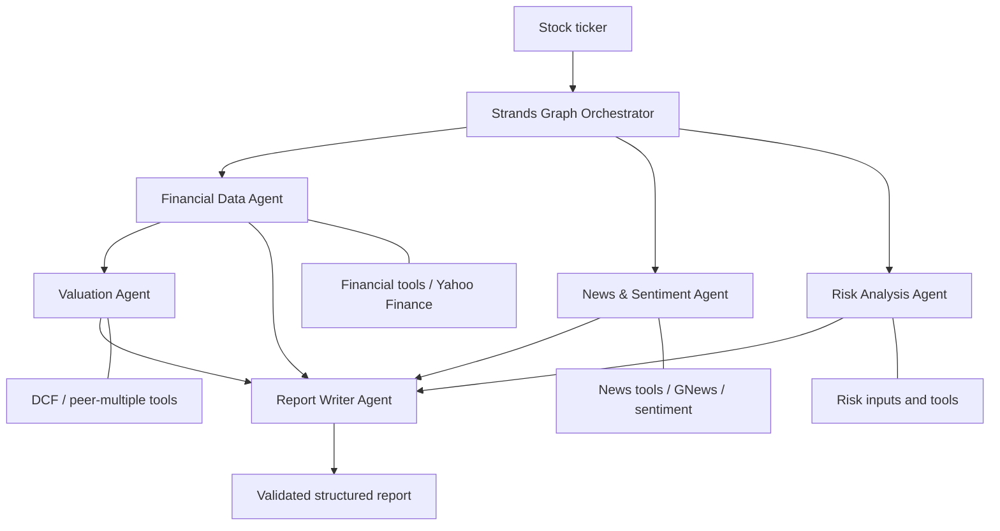

# FinJK — Fundamental Analysis Multi-Agent System

A Python-based, tool-using financial analysis workflow built with **Strands Agents**. FinJK coordinates specialist AI agents to retrieve financial statements, examine news sentiment and risks, estimate valuation, and assemble a structured investment-analysis report.

> **Project status:** The local multi-agent workflow has completed end-to-end tests. An AWS Lambda container-image deployment has returned a successful application response. An Amazon ECS Fargate batch deployment has been configured and launched, but its end-to-end execution is **not yet verified** because the Groq organization reached its token-per-day limit. Further deployment work is paused. This is a learning / research project, **not investment advice**.

## Contents

- [Overview](#overview)
- [Architecture](#architecture)
- [How the agents collaborate](#how-the-agents-collaborate)
- [Technology stack](#technology-stack)
- [Repository layout](#repository-layout)
- [Prerequisites](#prerequisites)
- [Local setup](#local-setup)
- [Run the application](#run-the-application)
- [Testing](#testing)
- [Docker](#docker)
- [Cloud deployment status](#cloud-deployment-status)
- [Reliability and limitations](#reliability-and-limitations)
- [Security and costs](#security-and-costs)

## Overview

FinJK accepts a **stock ticker** (for example, `AAPL`) and orchestrates several specialized agents to produce a financial-analysis report. The workflow emphasizes:

- Separation of **deterministic tools** (fetching/calculations) from **LLM agents** (interpretation).
- **Pydantic structured outputs** for each specialist and the final report.
- Parallel execution of independent analysis agents and an explicit dependency from financial data to valuation.
- Validation and conservative handling of missing information: an unavailable result should not be invented.
- Modular local execution and experimentation with AWS deployment options.

### Inputs and outputs

**Input:** Stock ticker, supplied to the orchestrator or a deployment entry point.

**Output:** A structured report combining available financial health, news sentiment, valuation, risks, supporting evidence and an overall recommendation. The exact fields are defined by the project's Pydantic report models; inspect those models for the canonical API contract.

The report can express **`UNKNOWN`** when inputs are incomplete or unreliable. A successful HTTP response does not by itself mean that every data source returned a usable result.

## Architecture



The **Financial**, **News & Sentiment**, and **Risk** nodes are independent starting nodes in the Strands Graph. **Valuation** depends on the financial node. The orchestrator collects and validates Graph results, then invokes the **Report Writer** to create the final report. The drawing summarizes dependencies; the Report Writer is invoked by the orchestrator after the Graph, rather than being a registered Graph node.

### How the agents collaborate

| Component | Responsibility | Representative tools / data |
| --- | --- | --- |
| Financial Data Agent | Income statement, balance sheet, cash flow, ratios and company health | `get_income_statement`, `get_balance_sheet`, `get_cash_flow_statement`, `compute_key_ratios` |
| News & Sentiment Agent | Recent headlines, sentiment and key factors | `search_recent_news`, `analyze_sentiment` |
| Risk Analysis Agent | Financial, business and regulatory risk assessment | Financial metrics and recent news |
| Valuation Agent | DCF and peer-relative valuation | `run_dcf_model`, `get_peer_multiples` |
| Report Writer Agent | Combine validated specialist findings into a final report | Specialist outputs; no independent market-data lookup |
| Orchestrator | Manage Strands Graph execution, dependencies and output validation | `GraphBuilder`, validated outputs |

The valuation agent is instructed not to fabricate upstream financial values. Peer-company lists must represent actual selected comparables rather than invented tickers. For the current Groq tool-call schema, `get_peer_multiples` expects a **list** for `peer_tickers` (an empty list where the application supports it), not `null`.

## Technology stack

| Layer | Technology |
| --- | --- |
| Language | Python 3.12 |
| Agent orchestration | Strands Agents, `GraphBuilder` |
| Model provider | Groq OpenAI-compatible API; `openai/gpt-oss-120b` used in development |
| Validation | Pydantic |
| Financial data | Yahoo Finance via `yfinance` |
| News | GNews API |
| Sentiment | VADER |
| Tool-result caching | `cachetools.TTLCache` and thread locks |
| Tests | `pytest` and mocks for deterministic tests |
| Packaging | Docker |
| Cloud experiments | Amazon ECR, AWS Lambda, Amazon ECS Fargate, AWS Secrets Manager, CloudWatch |

## Repository layout

The relevant project modules follow this structure (some other files, tests and configuration may exist):

```text
fundamental_analysis_agent/
├── agents/
│   ├── financial_data_agent.py
│   ├── news_sentiment_agent.py
│   ├── risk_agent.py
│   ├── valuation_agent.py
│   ├── report_writer_agent.py
│   └── orchestrator.py
├── tools/
│   ├── financial_tools.py
│   ├── news_tools.py
│   └── valuation_tools.py
├── providers/
│   ├── yahoo_finance.py
│   └── news_provider.py
├── deployments/
│   ├── lambda_handler.py
│   └── ecs_main.py
├── tests/
├── Dockerfile.lambda
├── Dockerfile.ecs
├── requirements.txt
├── .env                 # local only; never commit
└── README.md
```

> File paths reflect the current development structure discussed for FinJK. If a module or entry point has been renamed locally, use the corresponding path in your checkout.

## Prerequisites

- Python **3.12**, `pip`, and a local virtual environment.
- A **Groq API key** and a model available to your Groq account.
- A **GNews API key** for news retrieval.
- Internet connectivity for external market/news/model APIs.
- Docker Desktop for container testing (optional for Python-only development).
- AWS credentials and permissions only if exploring cloud deployments.

## Local setup

Run these commands in the repository root. On Windows PowerShell:

```powershell
python -m venv .FinJK
.\.FinJK\Scripts\Activate.ps1
pip install -r requirements.txt
```

Create a local `.env` file:

```dotenv
GROQ_API_KEY=your_groq_api_key
GROQ_BASE_URL=https://api.groq.com/openai/v1
GROQ_MODEL_ID=openai/gpt-oss-120b
GNEWS_API_KEY=your_gnews_api_key
```

**Never commit `.env`, credentials, log dumps containing secrets, or cloud access keys.** Ensure `.env` is in `.gitignore` and `.dockerignore`.

Your local entry point must load `.env` before constructing the agents, for example with `python-dotenv` and `load_dotenv()` if that is already used in your application.

## Run the application

### End-to-end Python workflow

Call the public orchestrator function from the project root:

```powershell
python -c "from dotenv import load_dotenv; load_dotenv(); from agents.orchestrator import run_fundamental_analysis; result = run_fundamental_analysis('AAPL'); print(result.model_dump_json(indent=2))"
```

This assumes the current orchestrator exposes `run_fundamental_analysis(ticker)` returning a Pydantic model, as in the Lambda/ECS entry points.

### Valuation Agent in isolation

A local diagnostic script (`test_valuation_live.py`, if retained) can run only the Valuation Agent. This is useful for debugging tool-call validation without invoking the whole Graph:

```powershell
python test_valuation_live.py
```

### Other ticker symbols

Use the symbol format accepted by your data source. For example, Yahoo Finance generally uses exchange suffixes for Indian stocks (such as `.NS`). Availability and completeness vary by company and sector.

## Testing

```powershell
# Deterministic/unit tests
pytest -m "not integration" -q

# All tests, including any live integration tests selected by your test suite
pytest -q
```

Live integration tests can incur Groq usage and hit API quotas. Prefer mocked/deterministic tests for routine changes. Do not assume every test is marked `integration` unless verified in your local test configuration.

The project has used pytest fixtures and cache clearing to isolate tests involving shared tool caches. Tests should validate both schema shape **and** `data_status`/missing-data behavior.

## Docker

There are **two image entry points** for distinct AWS runtimes:

- `Dockerfile.lambda` uses the AWS Lambda runtime and invokes `deployments.lambda_handler.lambda_handler`.
- `Dockerfile.ecs` uses an ordinary Python container entry point, `python -m deployments.ecs_main`, to perform one analysis and exit.

Build and run the ordinary ECS-style container **locally**:

```powershell
docker build --platform linux/amd64 -f Dockerfile.ecs -t finjk-ecs:latest .
docker run --rm --env-file .env -e TICKER=AAPL finjk-ecs:latest
```

The container can be stopped with `docker stop <container_id>` if run without `--rm` and still active. A local Docker container is **not** the same as an ECS task running in AWS.

## Cloud deployment status

### AWS Lambda — validated

FinJK has been packaged as a Lambda-compatible container image, stored in ECR, and invoked successfully with an `AAPL` test event. The deployment uses AWS Secrets Manager for API keys and CloudWatch for logs.

Example test event:

```json
{"ticker":"AAPL"}
```

The Lambda handler accepts the ticker, loads credentials, invokes the orchestrator, and returns a structured response. It has also been invoked from Python using `boto3` with an IAM identity authorized for `lambda:InvokeFunction`.

### ECS Fargate — configured; final end-to-end validation pending

- Repository: `finjk-ecs` in Amazon ECR.
- Cluster: `finjk-cluster`.
- Task definition family: `finjk-task`.
- Batch approach: run **one task**, print the result, then stop; no continuously running ECS service is required.
- Task execution role: `ecsTaskExecutionRole` for image pulls, Secrets Manager injection, and CloudWatch logs.
- An ECS task was launched, but the Groq organization hit a **200,000 tokens-per-day** quota during testing. A successful complete Fargate report has not yet been confirmed.

To avoid idle Fargate compute charges, confirm that debugging tasks have reached `STOPPED` and that no unintended ECS service is maintaining desired running tasks.

### Future work

Bedrock AgentCore Runtime and any production-facing HTTP API/authentication layer are **not yet completed**.

## Reliability and limitations

**External LLM calls are not guaranteed to return valid tool arguments on every attempt.** During development, the valuation node intermittently failed with model-generated `json`/`commentary` tool names, malformed structured-output fields, or parsing failures. Some subsequent identical runs succeeded. These errors are distinct from HTTP `429` quota errors.

Practical reliability priorities:

1. Validate agent outputs against Pydantic models and check their `data_status`.
2. Use **bounded, targeted retries** for transient errors; do not blindly restart the entire Graph after every failure.
3. Fail fast on known exhausted daily token quotas, and ensure one-shot ECS processes exit nonzero on failures.
4. Include agent/node names and error types in logs; never log API secrets.
5. Revisit sector-specific valuation assumptions (e.g., financial-services DCF), currency formatting, unavailable peers, and incomplete news coverage before interpreting results as investment-grade evidence.

**A successful HTTP `200` only indicates the application completed its request**; inspect the final report for missing data and conservative fallback values.

## Security and costs

- **Groq** bills/accounts for model usage separately from AWS. Groq's API limits (including **tokens per day**) may interrupt analysis with HTTP `429`.
- **Lambda** generally incurs compute charges during execution; invocation frequency, duration and memory affect costs.
- **Fargate** incurs task compute charges while resources are provisioned/running; stop unused batch tasks.
- **ECR**, **Secrets Manager**, and **CloudWatch** can incur storage or usage charges even between test invocations.
- Use IAM least privilege: distinguish the **deployment IAM user**, **Lambda execution role**, and **ECS task execution role**.
- Use Secrets Manager for deployed API keys and local `.env` only for development.
- Avoid publicly accessible unauthenticated endpoints; if exposing an API, add authentication, rate limits and usage monitoring.
- Set AWS billing alerts and monitor Groq quota/usage independently.

## Disclaimer

FinJK is an educational, experimental financial analysis system. Financial data, peer comparisons, sentiment, valuations, and AI-generated explanations may be stale, incomplete, simulated, or incorrect. Outputs are **not personalized financial advice**, and no investment decision should rely solely on this tool.
